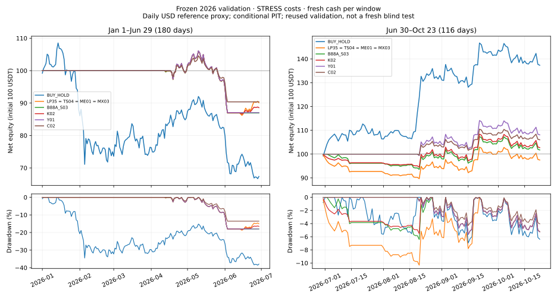

# 2026两段冻结模型验证

## Charter：目标和判据

本轮只验证当前仓库发布的九项策略及其六类模型，不搜索alpha、不新增策略、不用验证结果选参数。训练经济日期仅 **2017-01-01—2025-12-31**；2026不参与模型训练、标准化拟合、内层参数选择、年度风险或退出规则选择。

两段主验证为 **2026-01-01—06-29（180日）**、**2026-06-30—10-23（116日）**，共296日、无缺日、无重叠。每段100USDT、空仓开始，段末平仓并计费；固定同一2026模型跨两段运行。另跑Jan1—Oct23连续账户，区别资金重置和持仓跨界。此前逐年前推开发历史保持2018—2025，不把2026追加为测试或训练样本。

**结论：训练/验证隔离、固定规则及账本复核通过；价格数据质量有条件，C04缺数据被阻断，策略未证明持续alpha。** 2026此前已有验证消费，本次是冻结规则复验，不能称首次盲测。两段都不能再当成从未看过的新鲜保留集。

## Canonical sources：来源和标准

1. [预注册合同](PROTOCOL.md)、[模型合同](MODEL_CONTRACT.json)、[训练封存](training/seal.json)、[实际评估输入注册](intake/EVALUATION_REGISTRATION.json)和[结果哈希](results/validation-seal.json)。原历史发布`e2ff55c`，研究ledger `ea1256c6`。旧881项历史证据未更改。
2. [原295日及补齐日价格封存](intake/data-seal.json)、[完整296日验证原始数据](intake/prices-2026.json)。原Jan1—Oct22价格逐行不变；Oct23取同一事实发布者[BitcoinBTCSats月表](https://www.bitcoinbtcsats.com/price/usd/2026/10/)的完成日**close=81074 USD**，不是日均81191。抓取时间2026-10-25；Oct24/25不进入预测、标签或账户。
3. [Federal Reserve SR26-2及附件](https://www.federalreserve.gov/supervisionreg/srletters/SR2602.htm)，2026-04-17发布并取代SR11-7。参考其概念合理性、结果分析、持续监控及限制披露；它面向银行模型风险治理，不是本crypto项目的监管适用声明或国际认证。
4. [scikit-learn 1.6时间分割文档](https://scikit-learn.org/1.6/modules/generated/sklearn.model_selection.TimeSeriesSplit.html)：按过去训练、未来评价的时间顺序。实际拟合沿用原研究实现，不声称调用该API或随机交叉验证。搜索偏差、PBO/DSR来源与限制见[原方法证据](../../docs/EVIDENCE_SOURCES.md)。

“严格”在这里指可以检查的时间边界、冻结版本、完整成本和账本，不意味着有一项通用国际标准能保证策略有效。

## Findings ledger：实际执行和结果

### F1．训练与验证物理隔离

- 训练容器无网络、只读根文件系统、非root、无额外capability；只挂载2017—2025物理输入和输出目录，不挂验证文件、旧ledger或旧交易工程。[训练隔离与旧封存数值对照](training/isolation-and-prior-parity.json)记录实际镜像及哈希。
- 3287日训练前缀；长标签2968个、短头共同标签2951个。最后长/短标签均到index3280，训练cut=3286，保留6日embargo；标签终点i+61/i+62都在cut−6之前或相等，没有跨入2026。
- 六族：CAL44基础ExtraTrees、STOP监督CAL44、STOP监督PRICE47、DYNAMICS矿业58维、双lag Huber短头、双lag median短头。原7种子、过去内层块和固定profile沿用，实际168次拟合、56个最终成员。矿业族可以用历史训练，但没有合格2026输入供评价。
- 年度U02/Y01风险和退出规则复用先前在2025年底前缀上已封存的2026版本，不重新搜索。C02/C04资格仅按2025年底前的冻结历史正预测数决定。九策略的局部止盈、追踪及仓位差异保留原定义。
- 验证进程不导入训练worker，估计器与标准化器fit入口阻断；实际`validation_fitting_calls=0`、`model_selection_calls=0`。验证A只读到Jun29，验证B可用此前已发生价格作因果滚动特征，不重拟合、不选择规则。
- 原Native撮合及独立Decimal核算保留。108个完整账户的独立审计全部PASS；12项C04阻断行保留。新代码在首个经济运行前50项测试通过；[实际执行收据](verification/execution-receipt.json)及[安装代码隔离核验](verification/installed-code-preflight.json)保留。结果生成后再以纯标准库Decimal核对所有净收益、回撤和多空盈亏，见[逐账本交叉核验](verification/account-crosscheck.json)。

### F2．两段主结果

下表均为原预定 **STRESS** 成本，单元格是**区间净收益 / 最大日度回撤**，不是年化收益。独立账户均从100USDT开始。

|策略|Jan1—Jun29|Jun30—Oct23|
|---|---:|---:|
|LP35|−9.88% / 18.70%|−2.48% / 10.33%|
|TS04|−9.88% / 18.70%|−2.48% / 10.33%|
|ME01|−9.88% / 18.70%|−2.48% / 10.33%|
|MX03|−9.88% / 18.70%|−2.48% / 10.33%|
|B88A_S03|−13.06% / 17.99%|+1.75% / 6.42%|
|K02|−11.42% / 18.34%|+2.72% / 5.64%|
|Y01（纯多头）|−12.95% / 17.98%|+8.09% / 5.67%|
|C02（降仓）|−9.62% / 13.56%|+6.01% / 4.30%|
|C04|BLOCKED，缺矿业数据|BLOCKED，缺矿业数据|
|买入持有|−32.64% / 38.56%|+37.33% / 6.96%|

LP35/TS04/ME01/MX03不仅汇总相等：两个主窗口和连续窗口、四成本的marks/fills/trades/financing逐项完全相同，共36组比较。原分支差异在这段路径未产生不同成交，不能把它们视为四份独立alpha证据。

前段C02亏损最少、日度回撤最小，属于降低风险暴露的表现；所有策略仍亏损。LP35比B&H少亏22.76个百分点。后段B&H显著领先全部策略，LP35落后39.80个百分点；C02的低回撤伴随少参与上涨。观察到的日度回撤均低于用户45%阈值，不能保证未来或盘中也低于45%。

四成本全部保留在[120行CSV](tables/all_costs_and_windows.csv)及[原结果JSON](results/results.json)，没有按成本挑赢家：

|成本|每边手续费|报价滑移|信号执行lag|空头年化模拟融资|
|---|---:|---:|---:|---:|
|BASE|0.10%|0.05%|1日|5%|
|STRESS|0.30%|0.10%|1日|10%|
|SEVERE|0.50%|0.20%|1日|30%|
|DELAY|0.30%|0.10%|2日|10%|

四档成本下的净收益范围如下，端点来自全部情景，不表示置信区间：

|策略|前段最差—最好|后段最差—最好|
|---|---:|---:|
|LP35及三个相同路径分支|−11.14%—−8.53%|−7.54%—−0.60%|
|B88A_S03|−13.69%—−12.10%|−3.83%—+3.61%|
|K02|−12.22%—−10.01%|−2.76%—+3.89%|
|Y01|−13.27%—−11.40%|+2.12%—+8.51%|
|C02|−9.95%—−8.52%|+1.60%—+6.40%|
|B&H|−32.84%—−32.22%|+36.40%—+37.92%|

尤其后段DELAY情景，B88A_S03为−3.83%、K02为−2.76%，STRESS下的小幅盈利对执行延迟不稳健；LP35的四成本结果均亏损。不能只看STRESS正收益判断策略有效。

费用、融资、年化波动、Sharpe(rf=0,365日)、Sortino、Calmar、换手、实际止损亏损、前后gross和空仓日数均逐行保存。短窗口年化量仅作描述，不作为未来收益推断。B&H无止盈止损，预定日历首日成交、末日卖出，100%预算包含费用、一分储备和数量步长。

### F3．交易数量与方向归因

STRESS下LP35前段3笔交易（1多2空），成交后有仓62/180日；Y01和C02各1笔多头，有仓46日。LP35后段6笔（1多5空），有仓90/116日；Y01和C02各1笔多头，有仓64日。样本很小，单笔收益和路径依赖影响很大。

|策略|前段多头净盈亏USDT|前段空头净盈亏USDT|后段多头净盈亏USDT|后段空头净盈亏USDT|
|---|---:|---:|---:|---:|
|LP35及三个相同路径分支|−12.95381|+3.07266|+7.27633|−9.75378|
|B88A_S03|−12.95381|−0.10317|+7.57332|−5.82493|
|K02|−12.95381|+1.53633|+7.64757|−4.92882|
|Y01|−12.95381|0|+8.09306|0|
|C02|−9.62283|0|+6.01411|0|

净盈亏已含对应费用/融资，可加回期末净值。[所有成本方向归因](tables/realized_direction_decomposition.csv)可核查。后段空头拖累是账本事实；不能把删除空头的账面加法当作可交易反事实，因为资金、冷却、数量取整、后续入场及复利都会改变。

### F4．连续账户与分段重置不同

|策略|Jan1—Oct23连续净收益|最大日度回撤|
|---|---:|---:|
|LP35 / TS04 / ME01 / MX03|−10.10%|22.01%|
|B88A_S03|−11.52%|23.26%|
|K02|−8.02%|20.24%|
|Y01|−5.97%|18.49%|
|C02|−4.20%|13.96%|
|C04|BLOCKED|—|
|B&H|−9.28%|39.56%|

LP35在Jun30带入−0.00066 BTC空仓位；连续账户前段终值约90.11885，后段从该资金和持仓出发，段收益约−0.24422%，最终89.89876。与后段全新100USDT账户的−2.47746%不同。B&H连续持仓的后段约+34.66974%，也不同于重买的+37.32634%。因此不能相乘两段独立验证收益冒充连续策略业绩。[原结果](results/results.json)中的`continuous_segments`保留完整桥接。

### F5．六类预测模型评价

只评价标签在各段内完整成熟的样本，绝不读取Oct23之后价格。长头为120/56样本，双lag短头共同样本为119/55；它们是重叠60日目标，不是独立的每日涨跌试验，也不是校准概率。

|模型|前段MSE skill / 符号准确率|后段MSE skill / 符号准确率|
|---|---:|---:|
|base_tree CAL44|+0.255 / 66.67%|−1.271 / 8.93%|
|stop44|+0.289 / 73.33%|−0.866 / 8.93%|
|price47|+0.297 / 68.33%|−0.871 / 8.93%|
|short_huber|+0.235 / 73.95%|−1.098 / 12.73%|
|short_median|+0.038 / 68.07%|−0.559 / 43.64%|
|mining58|BLOCKED|BLOCKED|

MSE skill=1−模型MSE/训练期常数均值基准MSE；负值表示比冻结的训练均值更差。MAE及训练中位数基准另见[模型CSV](tables/raw_model_metrics.csv)。原始目标与交易风控后的净收益是不同对象，不能由一个直接推断另一个。后段原始预测明显失配，与策略未跟上上涨相符，但不足以证明具体市场因果机制。

### F6．不确定性

按合同做同日配对log return循环区块bootstrap，2000次、固定种子20261025；14日为预定主块长，同时保留7/28日。LP35前段相对财富超额+33.78%，14日描述区间[−22.33%,+150.60%]；后段−28.98%，区间[−51.38%,−3.59%]。这里是相对财富之比，不是表中的收益差百分点。完整结果保留所有策略和块长，不按区间选择模型。

重叠信号、少量交易、同市场/共享模型、历史搜索及已消费验证使这些区间不等于独立显著性证书。7日/14日/28日结果也非独立试验。有效搜索次数不明，因此不伪造DSR、PBO或“95%确定未来赚钱”的结论。

## Scope filter：数据和执行适用边界

- 价格是日度USD参考系列，不是可直接成交的交易所BTCUSDT行情。Oct23收盘时区、历史发布vintage及USD/USDT价差未经独立核实。Yahoo交叉核查不可用/429后停止重试；Investing缓存为Oct23盘中20:12，已拒绝作为完成收盘确认。完整日期覆盖不能升级为严格venue-PIT认证。
- C04需要原observer/header谱系一致的lag60矿业延续，原observer最后为2025-12-01、header上限926039；两段分别需要观测延至约Apr30/Aug24。实际上游HEAD仍未延续至所需日期。因此C04全部12条策略/成本/窗口行、矿业模型2条预测评价保持BLOCKED，没有用零、前填、后来快照或不相干哈希率替代。这是尚未完成该策略数值验证，不是收益为零或通过。
- Native保证金撮合、外置融资调整与独立账本核算可复现，但没有真实借币供给、盘口深度、跳空成交、盘中强平和融资后原生钱包清算保证。日度止损触发不等于最大可成交亏损；LP35本段单笔最大实际亏损约16.21%，高于15%触发阈值。
- 本轮没有运行旧讨论中未随当前仓库发布的GRU/TCN/Ridge等模型；“全部”范围为当前发布的九策略/六模型族，避免混淆旧实验命名空间。

## Object filter：证据独立性和审计轨迹

冻结时点有明确记录：先`6ecc89f`注册合同和训练，`a79fc1a`封存模型/评估代码，再摄取新的Oct23数据。两项实施修正保留原记录，不能抹去后再宣称全流程未动：

1. [实施修正01](IMPLEMENTATION_AMENDMENT_01.json)：Oct23来源摄取后、任何新验证预测/账户之前，修正首个2026决策日2025Dec31的available和降仓资格标志。回归只用2017—2025数据；模型、政策、超参及经济阈值未变，50测试先通过后运行。原MODEL_CONTRACT不回写，由old/new SHA显式绑定。
2. [未运行草稿](intake/UNUSED_DRAFT_NOTE.json)：初版推理挂载的共同来源元数据包含Oct23 OHLC，虽不作为算法输入仍应去除。草稿没有产生任何预测/账户；实际使用v2输入只保留来源身份，共同元数据不暴露后窗OHLC，窗口A价格文件截至Jun29。原草稿注册和说明保留。

上述修正与已有2026暴露史使本轮不具备“完全首次盲测”的资格；它们没有把2026观察送入拟合，也没有按验证收益改变经济参数。首个实际经济运行即交付的108账户，无挑选失败结果或重复搜索。

## Conclusions：目前能支持什么

历史高收益分支本轮前段防御性优于持有，但仍有绝对亏损；后段显著错过BTC上涨，空头进一步拖累。C02在观察窗口降低日度回撤，也降低上涨参与度。**这些结果不足以支持历史5000%/10000%收益可以持续，也不足以取得paper/live资格。** 训练隔离通过是一项程序性结论，持续alpha是另一项尚未证明的经济结论。

## Next steps / Risks：保持验证纪律

封存当前模型、两段结果和所有失败/阻断，不基于2026结果继续调参或选赢家。C04只有补齐可审查的同源历史因子后才能单独发布新版本验证，不能覆盖本次BLOCKED。若以后提出新策略，2026只能作为已消费的诊断历史，必须预先声明另一段从未观察的未来保留窗才可称新鲜OOS。本轮不启动该研究或生产交易。
